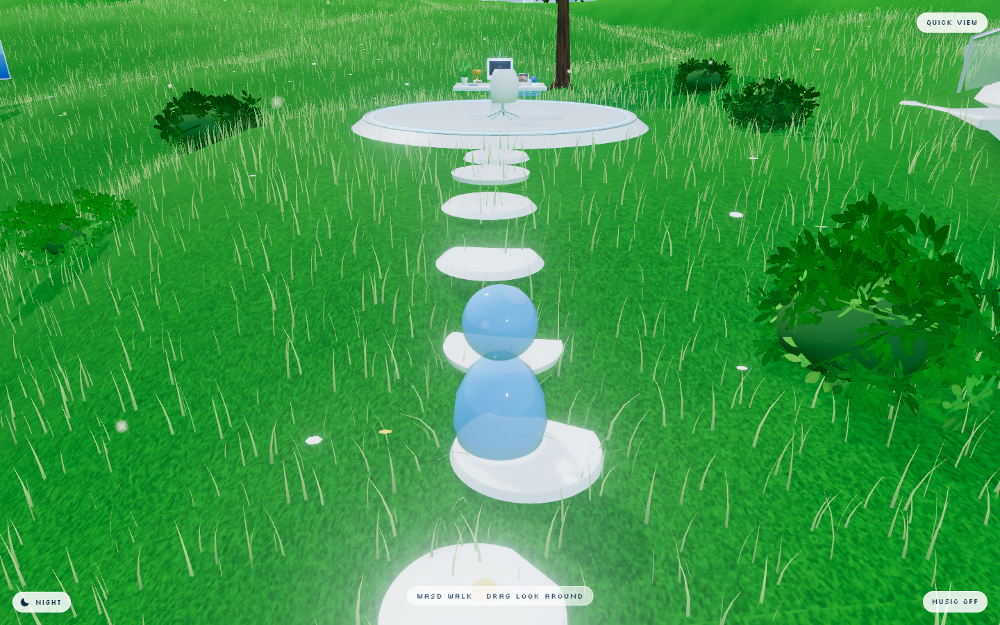
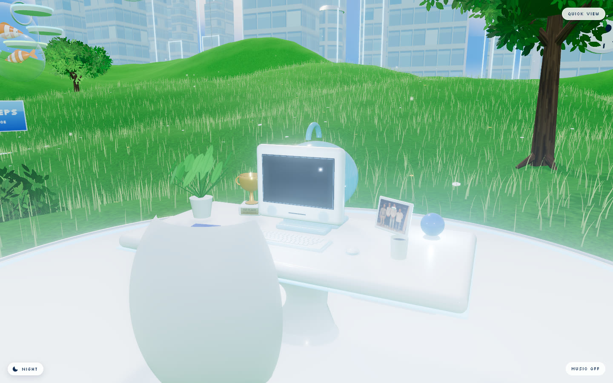
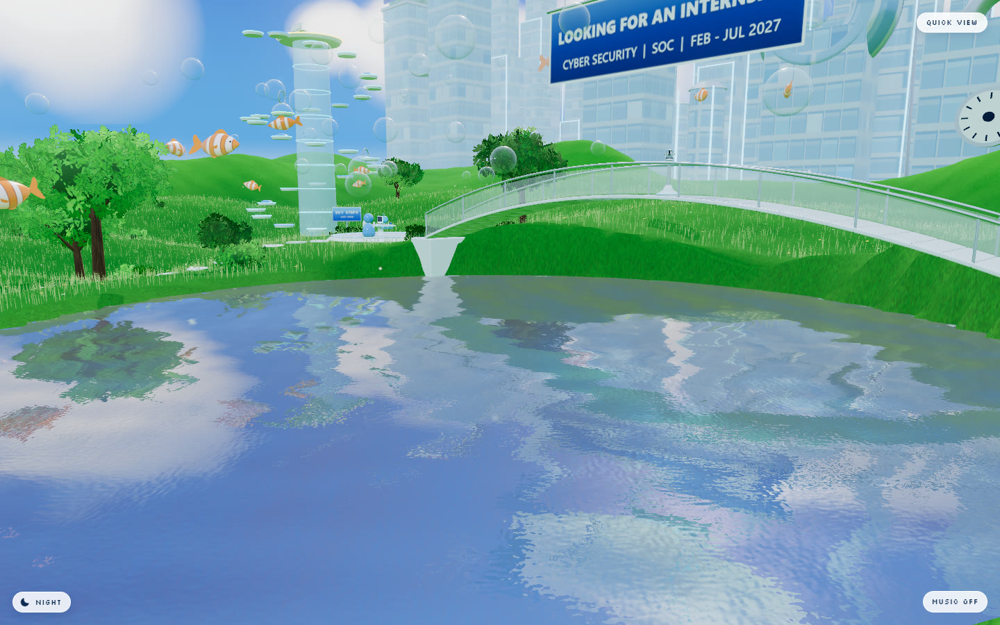
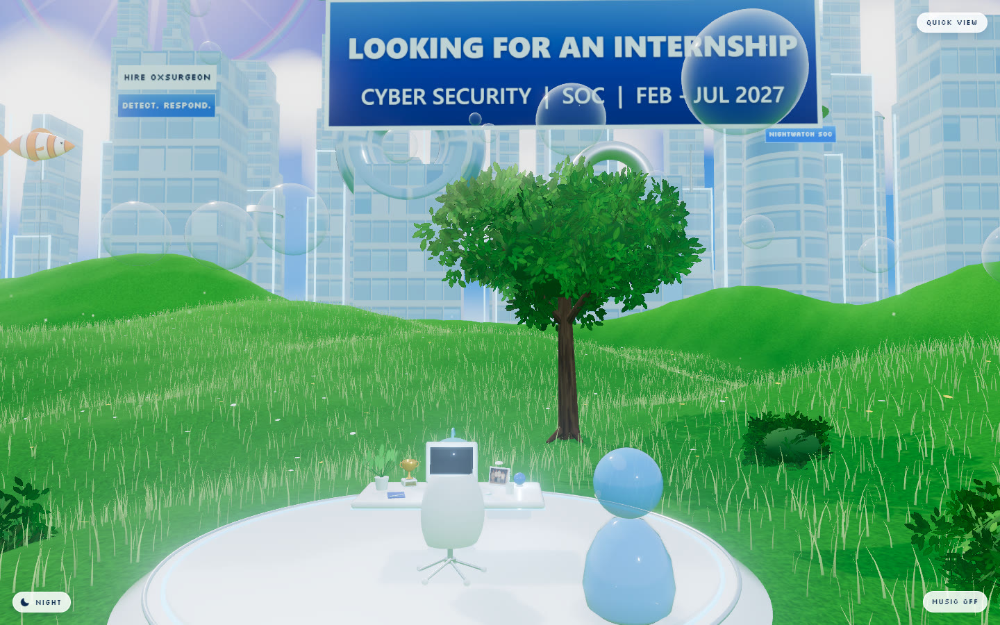

# stongeren.github.io

**My portfolio as a place you walk through.** Instead of a page with cards, you get a small 3D world in the style of the late 2000s: blue sky, green hills, glossy glass and white plastic. Walk to the desk, sit down, and the camera zooms into the computer, where the portfolio runs as its own little operating system.

Visit: **[stongeren.github.io](https://stongeren.github.io/)** · Short on time? The **[quick view](https://stongeren.github.io/cv/)** is a plain one-page version.

## What you can do

- **Walk around** with WASD, drag to look, jump, and pop the bubbles that drift past.
- **Sit at the desk.** The screen turns into a desktop with windows you open with one click: About me, Projects, Experience, Skills, Write-ups and Contact.
- **Play inside the OS:** a command prompt, a media player, and two small security games: *Phish or Not* (spot the phishing mail) and *Chain Watch* (the biggest crypto hacks as a chain of blocks).
- **Explore:** a lake with a footbridge and a telescope, a glass city on the horizon, fish and penguins in the sky, a whale, and a set of hidden landmarks with a security theme.
- **Switch to night** for a sunset, a neon city and a different playlist.

## Why like this

Recruiters see a hundred portfolios that look the same. I wanted one that people remember, that shows I can build something complete and polished, and that still gets the important facts across in under a minute through the quick view.

## Tech

- **Three.js** for the world: terrain, instanced grass, water with reflections, bloom, and creatures built from code.
- **CSS3DRenderer** to put a real HTML operating system on the 3D screen, so the text stays sharp and selectable.
- **Vite** build, deployed to GitHub Pages by a GitHub Actions workflow on every push.
- Works on phones: the left half of the screen walks, the right half looks around.

---

[Stefano van Tongeren](https://github.com/STongeren) · [LinkedIn](https://www.linkedin.com/in/stongeren/)
